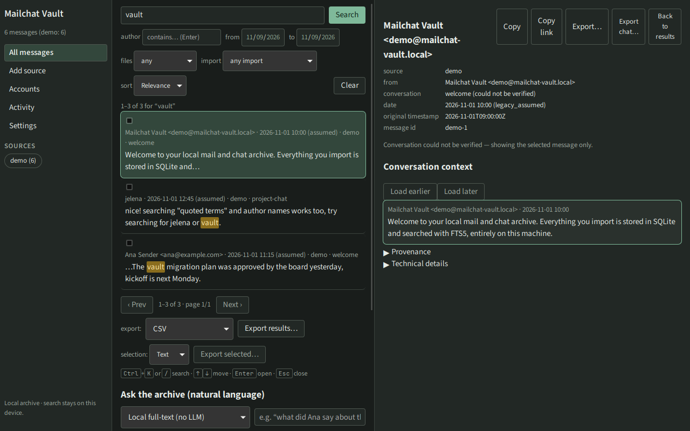

# Mailchat Vault

Mailchat Vault is a local email and chat archive — a Tauri 2 desktop app (Rust backend, TypeScript frontend) with SQLite FTS5 full-text search over your own messages.



The archive and search stay on your machine, and search works fully offline. Network use is separate and explicit: connecting an account contacts your mail provider (Google sign-in contacts Google; IMAP sync is read-only), and optional [AI-assisted search](docs/ai-search.md) sends the query and the top matching rows to a configured provider only after an explicit consent prompt. The app does not encrypt the archive or backups itself — at rest they rely on your OS account and disk protection.

## What it does

- Imports `.mbox`/`.eml` mail and WhatsApp, Telegram, Signal, Discord, and Messenger exports — single files, folders, or `.zip` — picked with the import buttons or dropped onto the window
- Bounded import preview before anything is stored; referenced media goes into a content-addressed store
- Incremental IMAP sync — Gmail (Google sign-in or app password) or any server
- Opt-in folder watching, scheduled auto-sync, and new-mail desktop notifications
- FTS5 full-text search with highlighting, filters, pagination, and conversation context
- Optional natural-language Ask: consent-gated, hybrid FTS + local-embedding ranking, source-linked answers
- Idempotent, deduplicating ingest — re-imports and re-syncs never duplicate
- Snapshot-backed migrations; staged, journaled backup/restore
- Background job pool keeps search responsive during imports and syncs
- Builds for Linux, macOS, and Windows

## Documentation

| Guide | Contents |
| --- | --- |
| [Feature reference](docs/features.md) | Features in detail: import, workspace, folder watching, jobs, export, media lifecycle, chat-format notes |
| [AI-assisted search](docs/ai-search.md) | Ask pipeline, consent, provider configuration, embeddings and hybrid ranking |
| [IMAP sync](docs/imap-sync.md) | Gmail and generic IMAP setup, credential storage |
| [Testing](docs/testing.md) | Test suites, performance budgets, fuzzing, CI |
| [Specification set](docs/README.md) | Product plan, UX spec, architecture, contracts, roadmap, decisions |
| [Download & install](docs/download.md) | Installer matrix, minimum requirements, checksum verification, limitations, upgrades |
| [Releases](docs/release.md) | Installers, smoke tests, checksums, publishing |

## Quickstart

Prerequisites: [Node.js](https://nodejs.org) 22+, [Rust](https://rustup.rs) stable, and on Ubuntu/Debian the Tauri system libraries (macOS/Windows need Xcode / MSVC):

```sh
sudo apt install libwebkit2gtk-4.1-dev libgtk-3-dev libayatana-appindicator3-dev librsvg2-dev
```

```sh
npm install
npm run tauri dev
```

An empty archive opens on **Add your first source**: import any `.mbox` or chat export, or load the isolated sample archive. The vault database lives in the app data dir (e.g. `~/.local/share/com.acailic.mailchatvault/vault.db` on Linux), with extracted media under `media/` next to it. Full walkthrough: [first-run tour](docs/features.md#first-run-tour).

## Development

```sh
npm test                 # frontend unit + UI-state tests
npm run check            # TypeScript type-check
cargo test               # vault-core suite
cargo test --workspace   # also the Tauri app tests
```

Details on budgets, fuzzing, and the hermetic IMAP/OAuth setup: [docs/testing.md](docs/testing.md). CI runs all of it plus `clippy` and `fmt --check`.

## Repository layout

```
crates/vault-core/   # storage, search, ingest, IMAP sync, jobs, media, backup — no UI deps
src-tauri/           # Tauri app shell: commands, events, providers, keyring secrets
src/                 # frontend (vanilla TS): workspace shell, search, sources, settings
```

Annotated layout: [feature reference](docs/features.md#annotated-repository-layout).

## Download

Prebuilt installers for Linux (AppImage/`.deb`), macOS (universal `.dmg`), and Windows (`.msi`/`.exe`) — with the version × OS × architecture matrix, minimum requirements, checksum verification, stated limitations, and the manual upgrade path — are on the [download page](docs/download.md). Artifacts are unsigned. Maintainer build and publish procedure: [docs/release.md](docs/release.md).

## License

GPL-3.0-only — see [LICENSE](LICENSE) and [decision D13](docs/decisions.md). Contributions use the DCO ([CONTRIBUTING](CONTRIBUTING.md)); security reports go through [SECURITY.md](SECURITY.md), not public issues.
