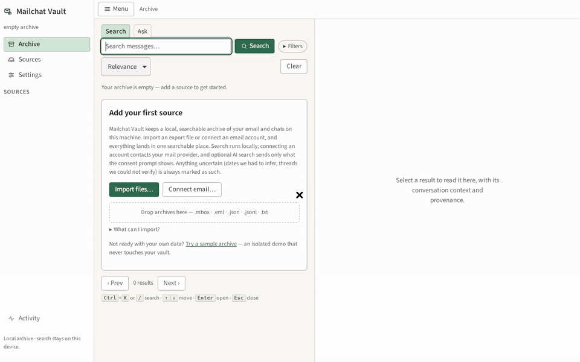
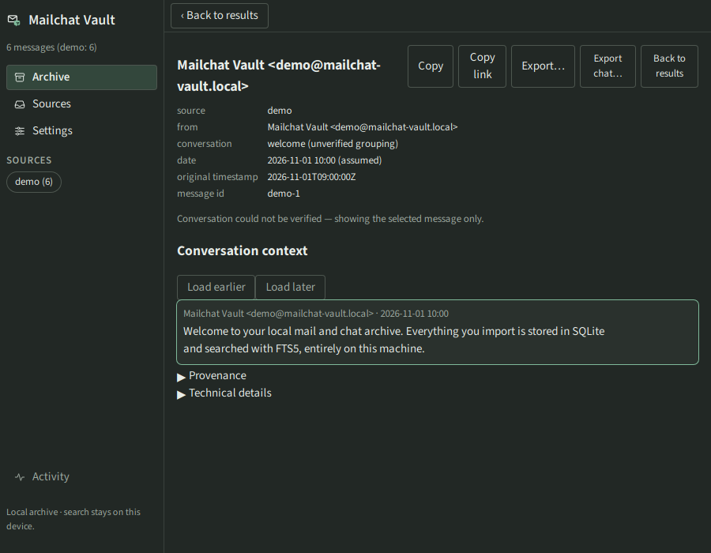
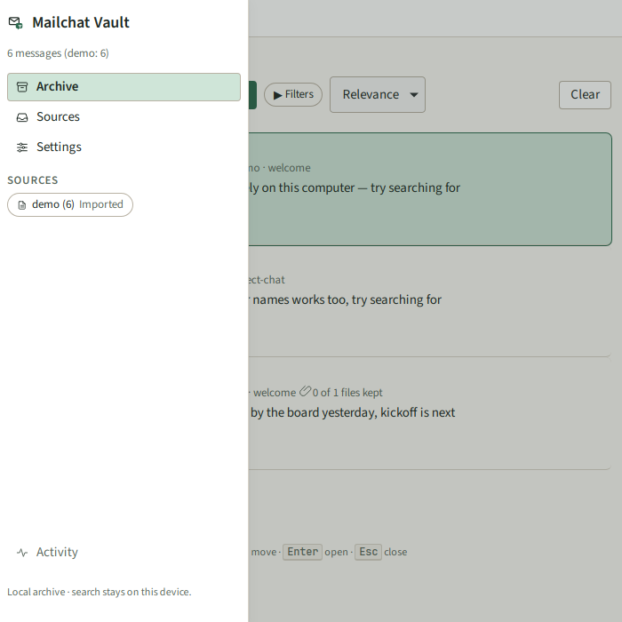
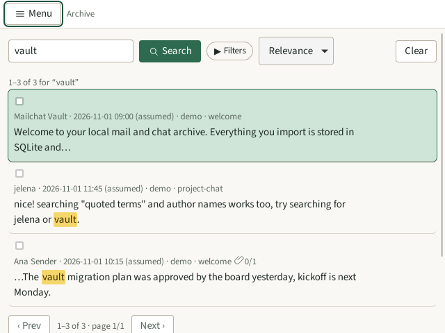

# Mailchat Vault

Mailchat Vault is one private, searchable archive for your email and your chats, on your own machine: drop in a Gmail Takeout export or a WhatsApp, Telegram, Signal, Discord, or Messenger export and find any message in seconds — fully offline, with no cloud service holding your messages.

[](docs/screenshots/README.md#demo-gif-readme-front-door)

[](https://github.com/acailic/mailchat-vault/releases/latest)
[](https://github.com/acailic/mailchat-vault/releases/latest)
[](https://github.com/acailic/mailchat-vault/releases/latest)
<!-- OpenSSF Scorecard badge — uncomment when the repository is public
     (owner action, docs/launch-checklist.md; Scorecard analysis only
     scores public repos, so the badge would render "no analysis" while
     private):
[](https://securityscorecards.dev/viewer/?uri=github.com/acailic/mailchat-vault)
-->

Installers for every platform, `SHA256SUMS` verification, and the version matrix: [download page](docs/download.md).

## How it compares

|  | Mailchat Vault | MailStore Home (Windows) | Mail Archiver X (macOS) | MailSteward (macOS) | Thunderbird + ImportExportTools NG | Gmail search | AI Emaily |
| --- | --- | --- | --- | --- | --- | --- | --- |
| Offline, local archive | Yes — archive and search work fully offline | Yes — local archive | Yes — local archive | Yes — local archive (Pro on a local MySQL server) | Yes — local mail folders | No — mail stays on Google's servers | No — cloud service |
| Email + chat in one archive | Yes — `.mbox`/`.eml` and IMAP/Gmail plus WhatsApp, Telegram, Signal, Discord, Messenger | Email only | Email only | Email only | Email only | Email only | Email only |
| AI search that never leaves the machine | Hybrid ranking with local embeddings runs offline (no model downloads); the optional AI ask is consent-gated and sends only what the prompt shows | No AI | No AI | No AI | No AI | AI (Gemini) runs in the cloud | AI runs in the cloud |
| Court-ready export | JSON Lines export keeps per-message provenance — source, resolved time + confidence, content hash, import receipt | No | Not stated by vendor | Markets FRCP compliance; mbox/SQL/text export | PDF/HTML/CSV export, no provenance | No | No |
| Open formats (mbox/eml export) | MBOX export (mail), CSV, JSON Lines round-trip; `.mbox`/`.eml` import | Restore-oriented export from its own archive format; no open export format documented | Not stated by vendor | mbox, SQL, tab-delimited text | EML, MBOX, PDF, CSV, plaintext | Google Takeout (`.mbox`) only | Not stated by vendor |
| Price | Free — open source, GPL-3.0-only | Free (private use) | $50 | $24.95–$99.95 (Pro needs MySQL) | Free | Free (Google account) | From $14.99/month, no free plan |

Competitor facts checked against vendor pages 2026-11; Mailchat Vault cells follow the tested claims in the [support matrix](docs/support-matrix.md).

Where the network is involved: the archive and search stay on your machine, and search works fully offline. Network use is separate and explicit: connecting an account contacts your mail provider (Google sign-in contacts Google; IMAP sync is read-only), and optional [AI-assisted search](docs/ai-search.md) sends the query and the top matching rows to a configured provider only after an explicit consent prompt. The app does not encrypt the archive or backups itself — at rest they rely on your OS account and disk protection.

## Screenshots

Captured from the running app with synthetic demo data in the light theme by the [workspace-layout e2e spec](tests/e2e/specs/16-workspace-layout.e2e.mjs); recipes for these and further views (import preview, Ask answers, settings, themes) are in [docs/screenshots](docs/screenshots/README.md).

| Wide workspace | Medium: reading replaces results |
| --- | --- |
|  |  |
|  |  |

## What it does

- Imports `.mbox`/`.eml` mail and WhatsApp, Telegram, Signal, Discord, and Messenger exports — single files, folders, or `.zip` — picked with the import buttons or dropped onto the window
- Bounded import preview before anything is stored; referenced media goes into a content-addressed store
- Incremental IMAP sync — Gmail (Google sign-in or app password) or any server
- Opt-in folder watching, scheduled auto-sync, and new-mail desktop notifications
- FTS5 full-text search with highlighting, filters, pagination, and conversation context
- Optional local voice-note transcription (whisper.cpp sidecar): search matches the words *said* in WhatsApp/Telegram voice messages, fully offline
- Optional natural-language Ask: consent-gated, hybrid FTS + local-embedding ranking, source-linked answers
- Idempotent, deduplicating ingest — re-imports and re-syncs never duplicate
- Snapshot-backed migrations; staged, journaled backup/restore
- Background job pool keeps search responsive during imports and syncs
- Builds for Linux, macOS, and Windows

## Documentation

| Guide | Contents |
| --- | --- |
| [Feature reference](docs/features.md) | Features in detail: import, workspace, folder watching, jobs, export, media lifecycle, chat-format notes |
| [AI-assisted search](docs/ai-search.md) | Ask pipeline, consent, provider configuration, embeddings and hybrid ranking |
| [IMAP sync](docs/imap-sync.md) | Gmail and generic IMAP setup, credential storage |
| [Testing](docs/testing.md) | Test suites, performance budgets, fuzzing, CI |
| [Specification set](docs/README.md) | Product plan, UX spec, architecture, contracts, roadmap, decisions |
| [Download & install](docs/download.md) | Installer matrix, minimum requirements, checksum verification, limitations, upgrades |
| [Releases](docs/release.md) | Installers, smoke tests, checksums, publishing |

## Quickstart

### Install in one line

Skip the build toolchain entirely — on Linux or macOS, one command installs (or upgrades to) the latest published release, verifies every download against the release's `SHA256SUMS`, never touches your vault data, and prints how to uninstall:

```sh
curl -fsSL https://raw.githubusercontent.com/acailic/mailchat-vault/main/scripts/install.sh | sh
```

Read the script before piping it to a shell — piping is a trust decision (it is short): [scripts/install.sh](scripts/install.sh). What it does, its flags (`--version`, `--no-launch`, `--yes`, `--uninstall`), and the unsigned-artifacts trade-off it makes on macOS are on the [download page](docs/download.md#install-in-one-line). No Windows one-liner yet — Windows uses the `.msi`/`setup.exe` installers.

### Run from a source build

Prerequisites: [Node.js](https://nodejs.org) 22+ (older majors crash vitest workers mid-run; enforced by the engines field), [Rust](https://rustup.rs) stable, and on Ubuntu/Debian the Tauri system libraries (macOS/Windows need Xcode / MSVC):

```sh
sudo apt install libwebkit2gtk-4.1-dev libgtk-3-dev libayatana-appindicator3-dev librsvg2-dev
```

```sh
npm install
npm run tauri dev
```

An empty archive opens on **Add your first source**: import any `.mbox` or chat export, or load the isolated sample archive. The vault database lives in the app data dir (e.g. `~/.local/share/com.acailic.mailchatvault/vault.db` on Linux), with extracted media under `media/` next to it. Full walkthrough: [first-run tour](docs/features.md#first-run-tour).

### Voice-note transcription (optional, offline)

Spoken words in voice notes are searchable when you turn the setting on and provide the sidecar tools — everything runs locally, nothing is uploaded:

1. Build or download [whisper.cpp](https://github.com/ggml-org/whisper.cpp) (MIT, CPU-capable) and a GGML model (e.g. `ggml-base.en.bin`).
2. Point the app at the binary: set `WHISPER_BIN` to its path (a binary bundled next to the app or anywhere on disk — `whisper-cli` found on `PATH` also works), put the model at `WHISPER_MODEL` (default looked up at `<data_dir>/whisper/ggml-base.bin`), and have `ffmpeg` installed for 16 kHz mono WAV conversion.
3. Enable transcription in Settings (strictly opt-in, default off).

Imports then queue voice notes for transcription — never slowed by it — and a separate pass transcribes them; plain search matches the spoken words afterwards. With any tool missing, imports work exactly as before and the feature reports itself unavailable (Settings shows what is missing). No model is ever downloaded automatically.

## Development

```sh
npm test                 # frontend unit + UI-state tests
npm run check            # TypeScript type-check
cargo test               # vault-core suite
cargo test --workspace   # also the Tauri app tests
```

Details on budgets, fuzzing, and the hermetic IMAP/OAuth setup: [docs/testing.md](docs/testing.md). CI runs all of it plus `clippy` and `fmt --check`.

## Repository layout

```
crates/vault-core/   # storage, search, ingest, IMAP sync, jobs, media, backup — no UI deps
src-tauri/           # Tauri app shell: commands, events, providers, keyring secrets
src/                 # frontend (vanilla TS): workspace shell, search, sources, settings
```

Annotated layout: [feature reference](docs/features.md#annotated-repository-layout).

## Download

Prebuilt installers for Linux (AppImage/`.deb`), macOS (universal `.dmg`), and Windows (`.msi`/`.exe`) — with the version × OS × architecture matrix, minimum requirements, checksum verification, stated limitations, and the manual upgrade path — are on the [download page](docs/download.md). Artifacts are unsigned. Maintainer build and publish procedure: [docs/release.md](docs/release.md).

## License

[](LICENSE)
[](https://github.com/acailic/mailchat-vault/releases/latest)
[](docs/download.md)

GPL-3.0-only — see [LICENSE](LICENSE) and [decision D13](docs/decisions.md). Contributions use the DCO ([CONTRIBUTING](CONTRIBUTING.md)); security reports go through [SECURITY.md](SECURITY.md), not public issues.
