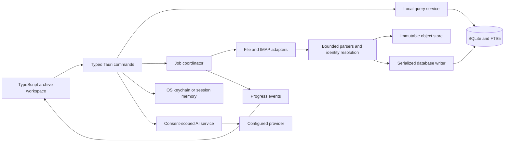

# Proposed architecture

Status: **mixed** — the overall plan retains the current Tauri/Rust/SQLite/TypeScript stack, the [jobs and database access](#jobs-and-database-access) section (M2.1–M2.4), the M4.1 half of [originals, media, and object lifecycle](#originals-media-and-object-lifecycle) (plus the M4.3 media handler that landed with #58), and the [optional AI ask layer](#optional-ai-ask-layer) section (M5 consent/citation halves), and the [backup and restore](#backup-and-restore) section (M4.4) are **current**, grounded in the implemented code; the notifications paragraph of [privacy, credentials, and failure reporting](#privacy-credentials-and-failure-reporting) is likewise **current** (M6-era, #59); the remaining sections are reviewed **proposed** design for their owning slices. Read the [assessment](project-assessment.md) for implemented behavior and [contracts](data-and-api-contracts.md) for authoritative data rules.

## Boundaries and data flow

The diagram describes future boundaries, not existing services or network infrastructure. All components except remote IMAP and the optional AI endpoint run in the desktop process. No server, cloud account, telemetry, or distributed job infrastructure is needed.

| Component | Responsibilities | Must not own |
| --- | --- | --- |
| Frontend | Workspace state, accessible rendering, consent preview, cancellation intent | SQL, credentials persisted in web storage, arbitrary filesystem access |
| Tauri adapter | Validate IPC, native dialogs, capabilities, keychain, scheduling, event delivery | Parsing or duplicated search logic |
| Core query service | Validated filters, bounded search/detail/context, stable result ordering | Remote network calls |
| Core ingest service | Normalize records, resolve identity, retain evidence, coordinate batch writes | Tauri APIs or UI strings |
| Source adapters | Read export/mail data and emit bounded records with provenance | Direct ownership of database transactions |
| Job coordinator | Lifecycle, per-source exclusion, cancellation, retries, issue reporting | Message bodies in progress events |
| Storage/object services | Transactions, migrations, FTS maintenance, copied bytes, integrity | Provider credentials |
| AI service | Existing compatible provider, validated plans, exact approved context and citations | Unapproved reads, attachments, arbitrary tools or SQL |

Keep `vault-core` free of UI dependencies. Split the frontend into IPC client, workspace state, feature controllers, pure view models, rendering, and styles. Keep pure transformation modules and existing stale-response defenses. Add an explicit typed IPC boundary instead of spreading string commands and casts through event handlers. A framework migration is unnecessary for this scope.

## Jobs and database access

**Current** (M2.1–M2.4; [jobs](../crates/vault-core/src/jobs.rs), [bounded ingest](../crates/vault-core/src/bounded.rs), [IMAP coordinator](../crates/vault-core/src/imap_coordinator.rs), [scheduler](../crates/vault-core/src/scheduler.rs); evidence in the [M2 completion record](implementation-roadmap.md#completion-tracking)). The vault is served by a database pool (`DbPool`): a **writer worker thread** owning the one write connection, **two read connections** each behind its own mutex (two reads run concurrently), and a **job runner thread**. Every connection initializes itself identically through `Storage::open` — WAL, foreign keys, the custom SQL functions, and a 5-second busy timeout (the original 2-second sketch was widened in implementation). Writes are closures submitted over a **bounded queue** (default 64 outstanding) and execute strictly one at a time in submission order; the capacity is the backpressure bound, so parsing or network producers can never accumulate an entire archive in memory, and `try_submit_job` refuses with a typed queue-full error instead of waiting. Reads never queue behind a commit under WAL, and all queries run on these blocking worker threads rather than the UI event loop.

Background jobs (imports, syncs, embedding runs, demo seeding) execute on the runner thread, **one at a time** — stricter than the proposed "at most two ingest jobs" cap. A job body holds no connection: it works through a `JobContext` whose read/write calls round-trip the pool, so network waits, parsing, and CPU work happen between storage calls. This is the structural contract behind responsive storage: **no network operation ever runs inside the writer, inside a storage lock, or inside a transaction** — proven by tests that park the mock IMAP server mid-fetch and complete a write and a search while the fetch is stalled, at single-account and coordinator-round scale. Do not hold any connection while waiting for network I/O, a provider response, native dialog, or user consent.

Every job carries a stable id and moves through typed states — `queued → running → succeeded | failed | cancelled` — with typed error kinds (`storage`, `io`, `import`, `network`, `cancelled`, `queue_full`, `invalid`, `internal`) instead of bare strings. The proposed `partial` and `interrupted` states are not implemented: a partial outcome (a folder that failed, an import that stopped early) is reported inside the job's result summary and issue ledgers, and restart recovery is the work's own durable state, not a persisted job row — job records live in the process registry (with a bounded finished-job history), so an app restart starts the registry empty while interrupted imports and syncs resume from their checkpoints. Cancellation is cooperative — checked per item in imports and between sources/fetch batches in syncs — so the UI must not promise instantaneous cancellation. Job bodies publish progress at safe points (per batch); the bounded import driver rate-limits to at most four events per second, and unknown totals are reported as zero, never guessed percentages. Every state change appends an event stamped with a global monotonically increasing sequence to a bounded ring; the v2 commands (`job_submit`, `job_get`, `job_list`, `job_events_since`, `job_cancel`) and the `job-event` window event carry them, and a client that missed events (webview reload) recovers by polling with its last-seen cursor: the page returns the gap, the newest sequence, a `trimmed` flag when the ring no longer holds part of it, and the current job snapshot to reconcile from.

Imports parse through bounded streaming sources (M2.2): a parser yields one item at a time (message or durable failure) and may re-read its input in bounded passes, keeping memory flat regardless of file size. The batch-commit driver flushes at **at most 200 items (messages plus recorded failures) or 8 MiB of accumulated body text per commit, whichever comes first**; a batch — message rows, issue records, and the checkpoint advance (or the checkpoint removal that completes the import) — lands in **one transaction**. A single oversized item still commits alone under the explicit capacity policy, never silently truncated. Cancellation stops the pull, discards the uncommitted partial batch, and leaves the committed counts truthful by construction; every parse failure becomes a durable issue row with its stream position. Restart recovery fast-forwards the same deterministic stream past the checkpoint's committed position — no duplicates, no re-parse of committed history, no lost failures. Import identity is the canonical path plus file length and mtime, so an unchanged file resumes across restarts while an edited file is a new import that re-dedups safely. The whole-archive `collect` helpers remain only as a convenience for small parser tests.

Live mail syncs through the coordinator (M2.3) described under [IMAP correctness](#imap-correctness); file imports, embedding runs, and demo seeding run through the same pool — the v1 import commands keep their synchronous IPC shapes while gaining the pool's guarantees, and the v2 job kinds (`import_mbox`, `import_chat_export`) run the identical bounded path on the runner. Maintenance jobs that need a stable object inventory pause new writers after current batches finish (**proposed**, M4); search remains available except during the final restore switch.

Manual sync is default. The optional scheduler (M2.4) is a user opt-in persisted as one schedule row (interval default 15 minutes, clamped to 1 minute–24 hours; off until enabled). It never calls the connector directly: each interval it submits one coordinator round as an ordinary `imap_sync_all` job, visible and cancellable in the same jobs panel. Scheduling is monotonic within a session and never queues missed intervals: there is one deadline anchored at the previous round's actual submission, at most one scheduled round queued or running, and a round that outlasts the interval simply delays the next — so sleep, resume, and offline gaps collapse into exactly one catch-up round. Disabling cancels an active round cooperatively; enabling arms one full interval out. Failed rounds keep the cadence; persisting an unbounded queue of missed intervals is impossible by construction.

### IMAP correctness

**Current** (M1.2 identities, M2.3 coordinator; grounded in [imap.rs](../crates/vault-core/src/imap.rs) and the mock-IMAP suites). Implicit TLS validation and read-only mailbox access (`EXAMINE`, never selecting read-write); fetching sets no read flags, deletes no mail, changes no folders. Fetch batches are at most 50 messages, and one batch's message rows, folder occurrences, issue/failed-item ledger rows, and the checkpoint advance commit **together** in one transaction — an interruption always leaves the cursor exactly at the boundary of durably stored work. Checkpoints are scoped by source instance, folder, and UIDVALIDITY. The cursor advances only through UIDs fetched successfully or ledgered as durable parse/storage failures; it never jumps over a transport or missing-body failure — those stay unfetched for the next round. Items the vault accounts for but cannot store (unparseable mail, a UID the server searched but never delivered) become durable failed-item ledger rows — fixed reason and attempt count, never message content — retried by every later round until they resolve, and visible per source. A UIDVALIDITY change starts a new occurrence epoch: the folder is rescanned from UID 1, re-fetched messages dedup through the connector identity, and the abandoned validity's ledger rows are cleared in the same commit that adopts the new one. A round never aborts on one source: missing credentials are reported (not errored), a failing source carries its error while the rest still sync, and per-source exclusion skips a source's syncing while keeping its archive, cursors, and configuration.

Source identity and credentials follow the [identity contracts](data-and-api-contracts.md#identity-and-deduplication): instances are addressed by opaque IDs with host/port-aware connector keys (canonicalized hosts and ports, exact username spelling — a password change is a credential update, not a new account), and the vault database stores no secrets — the coordinator resolves credentials per source at round time (OS keyring in the app, injected resolver in tests). Saving secrets only after successful connection validation and the disconnect/deletion flow (**proposed**, M3.4) build on this base.

## Optional AI ask layer

**Current** (M5 consent-gate and source-linked-answer halves; grounded in [lib.rs](../src-tauri/src/lib.rs), [llm.rs](../crates/vault-core/src/llm.rs), and the frontend wiring, recorded in the [M5 progress record](implementation-roadmap.md#completion-tracking)). The ask pipeline is composed so that no storage lock is held across a provider round trip: provider selection (settings profile → environment fallback → local-only) happens under a short registry lock, then the steps run separately — translate (network, no storage) → validate (one pool read) → run plan + hybrid rank (pool reads) → summarize (network). Each read round-trips the pool like every other command, mirroring the no-network-inside-a-lock rule above.

The **consent gate** is backend-enforced and sits before anything network-shaped exists: a network selection without explicit consent is downgraded to a fully local ask *before* any LLM client object is constructed, so no translate or summarize round trip can even start and nothing leaves the machine (proven by mock-endpoint tests that record zero wire requests). Consent is session-scoped and in-memory only — it resets on every app start and is never written to any storage — always visible in a status line, revocable mid-session; the first network ask of a session runs locally and shows a per-question prompt stating exactly what would leave and to whom, and agreeing re-asks the same question with the network leg enabled. A consented ask makes exactly two round trips; the summary payload is only the question plus the top `summarize_top` (default 8) results as numbered blocks (author, timestamp, body truncated to 500 Unicode characters) — no filenames, raw JSON, attachments, or embeddings — and is skipped when there are no results. Provider failure degrades, never breaks retrieval: an unusable translation falls back to a plain term plan, a failed summary leaves the local results with an explanatory note, and requests time out at 30 seconds.

Answers are **source-linked**: the summary prompt numbers its context blocks `[1]…[top]` in the same order as the returned results, citation `n` maps to result `n − 1` — a fixed map bound to that ask's outcome — and both the citation links and the numbered source rows beneath the answer open the original archived message in its conversation context through the v2 reading pane (`conversation_context_v2`). Markers beyond the summary window or outside the result list stay plain text, never dead links.

Honest deviations from the proposed flow (owned by the open M5.1/M5.2 slices): the consent switch is not persisted (session-scoped by design), asks are direct IPC commands rather than jobs (no job record, cancellation, or progress; a stalled provider is bounded only by the 30-second timeout), there is no digest-bound approval of an exact preview (a granted session consent covers the session's questions), and asks do not intersect the active workspace filters. No remote chat transcript is saved; messages are untrusted evidence, never instructions to the assistant.

## Originals, media, and object lifecycle

**Current** (M4.1; [object store](../crates/vault-core/src/object_store.rs), [import bounds](../crates/vault-core/src/import_bounds.rs), [media pass](../crates/vault-core/src/media.rs); evidence in the [object-store](../crates/vault-core/tests/object_store.rs) and [media suites](../crates/vault-core/tests/media_extract.rs)). The app data directory is the vault root: `vault.db` beside a content-addressed `media/` store. Objects are stored directly under `media/` as `<sha256>.<ext>` — byte-exact copies of their inputs, never transcoded or rewritten, named by the SHA-256 of their bytes; the extension is sanitized (lowercase alphanumeric, `bin` fallback) and kept only so stored files stay recognizable. Persisted references are store-relative paths (`media/<sha256>.<ext>`); no absolute path is ever recorded, so references stay valid wherever app data lives. A staging area (`media/.staging/`) holds in-flight writes and is invisible to object enumeration by construction.

Object write protocol — the lifecycle every media copy follows:

1. **stage** — bytes stream into `media/.staging/` while SHA-256 is computed over exactly the bytes written and the run's media budget is enforced: a per-import `Capacity` of at most 32 GiB of new object bytes and 100,000 new objects per run, with content already in the store refunded, so re-importing preserved media costs nothing.
2. **promote** — an atomic rename on the same filesystem moves the staged file to its final `media/<sha256>.<ext>` name or, when identical content is already stored under any extension, drops the staging file and reuses the existing object. Duplicate bytes therefore occupy one object — across names, messages, and imports.
3. **reference** — only after promote does the ingest batch commit record the digest in the message's `raw_json` `media` array (`sha256`, store-relative `path`, original display `name`, `kind`, `size`). Re-importing an export whose media now exists backfills links into already-stored messages (`attach_media`), which bumps `archive_revision` because attachment counts change.
4. An interruption at any point leaves a sound state: before promote, only invisible staging litter exists; during promote, the rename is atomic; after promote but before the reference commit, the object is a harmless orphan the next import of the same content dedups onto. A dangling reference — digest recorded, object absent — cannot be produced by this order; reconciliation finding one means external damage.

Reconciliation and repair: `Storage::media_digests()` collects every referenced digest from the canonical store; `ObjectStore::reconcile` re-checks the store against them and reports missing references, unreferenced orphans, corrupt objects (content hash ≠ name digest, re-hashed when verifying), staging litter, and foreign files. The read-only `media_reconcile` IPC command exposes the report (verification on: a maintenance call pays the re-hash). A clean import reconciles to zero of everything. Repair is deliberate: `sweep_staging` removes only staging litter older than 24 hours; object deletion and garbage collection under exclusive object-maintenance ownership with a grace period remain **proposed** — the current tools never delete an object, and deleting a message removes references, not objects still referenced elsewhere.

Every import tree — a directory walk or a ZIP expansion — passes through one traversal/symlink/capacity fence (M4.1 `ImportBounds`): relative references carrying `..`, absolute, or backslash components are refused lexically and re-checked after canonicalization (symlink escapes); symlink, device, and fifo ZIP entries reject the whole archive; file-count (20,000), total-byte (32 GiB), and depth (6) bounds cap runaway input; declared ZIP entry sizes are preflighted and actual streamed bytes re-checked, so a lying header cannot slip an expansion bomb through; nothing of a rejected archive is kept. A picked `.zip` expands through the fence into an OS-temp tree that lives exactly as long as the import, and wrapped single-subdirectory exports descend automatically. File names remain metadata — the original display name travels in the reference — never storage paths. Telegram media matches only the export's explicit relative `photo`/`file` references, resolved inside the export root; WhatsApp matches explicit named attachments (full name case-insensitively, then stem-matching that never lets a disk file's stem answer for a reference's full name). Signal and Discord attachments stay recorded in `raw_json` only — media extraction is not implemented for them yet. Media kinds derive from the export's own hints (generic placeholders defer) with the file extension as fallback.

**Proposed remainder** (M4.2/M4.4 — the M4.3 media display surface landed with #58, its acceptance record open with the milestone). Preserve raw RFC 5322 message bytes for mail and original export inputs as originals — MIME attachment/inline parts for email, with plain-text reading as the safe default and attachment text kept out of the message body unless it is the actual selected text part; preserve html-only originals and derive inert plain text; a picked ZIP itself becomes an original object beside its validated extractions; explicit per-message missing/failed states and a durable registry for unlinked source files (visible at source level, never assigned by proximity or filename guessing); generated thumbnails as disposable derivatives, never substitutes for originals. A versioned vault manifest and a separate sibling recovery directory (so ordinary object cleanup can never erase recovery data, and recovery manifests pin referenced objects against garbage collection until the user removes that recovery) belong to the backup/restore slice below. The narrow native media handler is **current** as landed by #58: a read-only `mcmedia://` protocol resolves strictly to single-component `<sha256>.<ext>` object names (no traversal, no percent-decode), serves exact byte-range slices asynchronously on the blocking pool, and sets a hard response CSP (`default-src 'none'` + sandbox, `nosniff`) with HTML never a servable content type — the frontend never receives an unrestricted filesystem URL, nothing autoplays, and active HTML or remote-resource fetch cannot execute; safe export copies bytes exactly and external open runs a disposable per-digest temp copy, so the store is never handed to an external writer ([UX media policy](ux-specification.md#media-and-storage)).

## Backup and restore

**Current** (M4.4; grounded in [backup.rs](../crates/vault-core/src/backup.rs), recorded in the [M4 completion record](implementation-roadmap.md#completion-tracking)). Backups are versioned ZIP64 containers containing `manifest.json`, a consistent SQLite snapshot, and referenced object bytes. The snapshot is taken with SQLite's backup API; copying only a live `vault.db` is unsafe under WAL. Secrets, transient logs, staging, and recovery snapshots are never included (the settings file carries no key material; the keyring is not part of any backup or switch). The manifest — written last, after every entry's bytes are hashed while streaming — records format/schema versions, source counts, relative paths, sizes, and SHA-256 checksums.

The shipped backup takes the snapshot on the writer connection (new writes pause behind the write queue after current batches finish; the referenced digests are read **from the snapshot**, so later writes cannot change what the container carries) and streams objects into a temporary destination file on the job runner with progress and cooperative cancellation; search stays available. On success the archive is verified (every entry re-read and re-hashed against the manifest) and renamed into place. On failure only the incomplete backup is removed; the vault is untouched and jobs resume. Backup destinations inside the vault root (or the recovery directory) are rejected. Preflight demands room for the database snapshot plus the final container plus slack.

Restore validates entry set, supported format/schema versions, checksums, SQLite integrity, foreign keys, object presence, and free space in a separate staging vault under the sibling recovery directory; newer unsupported formats are refused. Credentials are never restored. The validated preview is bound to the staged bytes and the active vault's fingerprint; the commit re-verifies both (a vault or staging area that changed since the preview is a refusal), then stops jobs, closes connections, and replaces the vault payload (`vault.db`, `settings.json`, `media/`) through a **two-phase switch journal** — journal `switching` (current vault moved aside) rolls back, journal `staged` (new vault moving in) rolls forward — so an interrupted switch always ends at one verified whole vault, recovered automatically at startup. The previous vault is kept as a recovery slot and never deleted automatically; the user can return to it through the same journaled switch or forget it explicitly. Reconnect restored accounts before scheduled access can run.

Before any schema migration, create and verify a database snapshot plus the current object manifest under exclusive writer ownership. Additive migrations do not rewrite object bytes; suspend garbage collection until migration succeeds. Recovery manifests pin referenced objects against garbage collection until the user explicitly removes that recovery snapshot. If migration or post-migration validation fails, reopen the original snapshot and present recovery guidance. An older application must refuse a newer schema instead of attempting downgrade.

## Privacy, credentials, and failure reporting

The vault and backups are not app-encrypted. Use restrictive owner-only permissions where supported and rely on the OS account/disk protections chosen by the user. Do not describe these controls as encryption provided by the app.

OS keychain entries use source IDs and provider-config IDs; session fallback is explicit. Never store passwords/API keys in SQLite, localStorage, backups, events, crash reports, or logs. Clear temporary credential inputs after use. Logs record operation IDs, durations, error codes, and counts; sanitize server errors before display/export.

**Current (notifications, #59 — recorded with the [M6 progress record](implementation-roadmap.md#completion-tracking)).** New-mail notifications are content-free by construction: a notification carries a count plus folder or file labels ("2 new messages — INBOX, Archive" / "imported from chat.txt"), never message bodies, subjects, or authors. OS notification permission is requested at the enabling gesture (the Settings toggle), never at startup; a denied permission or a missing OS notifier degrades silently — the archive data is already durably stored, so no data path depends on notification delivery. The option is a non-secret settings-file flag (on by default) and adds no schema or network surface.

The AI flow follows the explicit send decisions in [UX](ux-specification.md#optional-ask). **Current (M5)**: the shipped flow has one explicit send decision — the per-question consent prompt before the first network ask of a session, enforced in the backend as the consent gate above; the per-answer approval of the exact preview remains **proposed** with M5.2. Save no remote chat transcript by default. Keep the existing provider key/endpoint pairing protections. Plain local search and retrieved results survive provider failure. Messages are untrusted evidence, not instructions to the assistant; no tool execution or external navigation follows message content.

Use [typed errors](data-and-api-contracts.md#errors-and-events) at IPC boundaries. Partial work remains queryable, and progress/issue counts must explain it. Test disk-full, connection loss, interrupted object writes, and restore switching rather than treating them as generic string errors.

## Maintenance

Update [Decisions](decisions.md) when changing these boundaries. Performance changes require measurements on the actual query/job paths, while any new network operation requires updated payload disclosures and no-network tests. External dependency selection should be verified against official documentation during its implementation slice; this architecture does not claim to have verified future library APIs.
