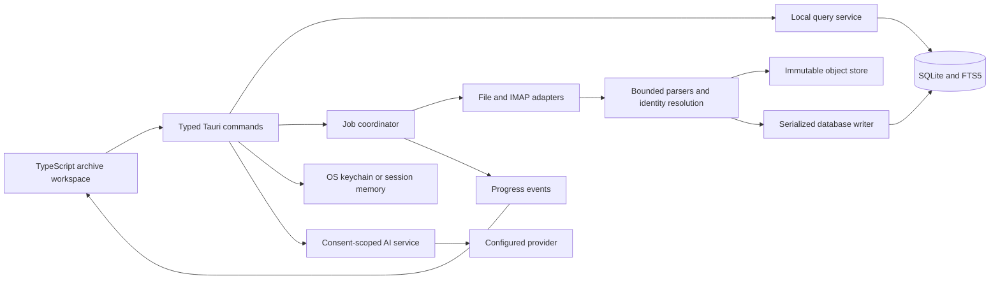

# Proposed architecture

Status: **proposed**, retaining the current Tauri/Rust/SQLite/TypeScript stack. Read the [assessment](project-assessment.md) for implemented behavior and [contracts](data-and-api-contracts.md) for authoritative data rules.

## Boundaries and data flow

The diagram describes future boundaries, not existing services or network infrastructure. All components except remote IMAP and the optional AI endpoint run in the desktop process. No server, cloud account, telemetry, or distributed job infrastructure is needed.

| Component | Responsibilities | Must not own |
| --- | --- | --- |
| Frontend | Workspace state, accessible rendering, consent preview, cancellation intent | SQL, credentials persisted in web storage, arbitrary filesystem access |
| Tauri adapter | Validate IPC, native dialogs, capabilities, keychain, scheduling, event delivery | Parsing or duplicated search logic |
| Core query service | Validated filters, bounded search/detail/context, stable result ordering | Remote network calls |
| Core ingest service | Normalize records, resolve identity, retain evidence, coordinate batch writes | Tauri APIs or UI strings |
| Source adapters | Read export/mail data and emit bounded records with provenance | Direct ownership of database transactions |
| Job coordinator | Lifecycle, per-source exclusion, cancellation, retries, issue reporting | Message bodies in progress events |
| Storage/object services | Transactions, migrations, FTS maintenance, copied bytes, integrity | Provider credentials |
| AI service | Existing compatible provider, validated plans, exact approved context and citations | Unapproved reads, attachments, arbitrary tools or SQL |

Keep `vault-core` free of UI dependencies. Split the frontend into IPC client, workspace state, feature controllers, pure view models, rendering, and styles. Keep pure transformation modules and existing stale-response defenses. Add an explicit typed IPC boundary instead of spreading string commands and casts through event handlers. A framework migration is unnecessary for this scope.

## Jobs and database access

Replace the app-wide connection mutex with a vault service containing one writer worker and two independently owned read connections. Configure WAL, foreign keys, per-connection SQL functions, and a bounded 2-second busy timeout on every applicable connection. A bounded writer queue prevents parsing/network producers from accumulating an entire archive in memory. Queries run on blocking workers rather than blocking the UI event loop.

Jobs parse and fetch outside database locks. Start with at most 200 messages or 8 MiB normalized text per commit, whichever comes first; retain IMAP fetch batches of at most 50 messages. A single oversized message is handled under the explicit capacity policy, not silently truncated. Yield between commits, respect cancellation, and publish progress at most four times a second. These are starting limits to validate with [performance tests](validation-and-release.md#performance-and-capacity).

Allow one import/sync per source instance, at most two ingest jobs overall, and one database writer. Multiple reads may run concurrently. Maintenance jobs that need a stable object inventory pause new writers after current batches finish; search remains available except during the final restore switch. Do not hold any connection while waiting for network I/O, a provider response, native dialog, or user consent.

Persist job state, counters, issues, and source configuration without secrets. Events are hints; polling persisted status recovers missed events. On restart, previously running jobs become interrupted and resumable rather than falsely completed. File imports restart from the preserved original or selected source and dedup safely; IMAP resumes its committed checkpoint. Durable parse failures are separate from retryable transport/storage failures.

Manual sync is default. The optional scheduler follows [product rules](product-plan.md#functional-requirements); it enqueues jobs instead of directly calling the connector. Use monotonic scheduling during a session and persist only settings/last outcomes, not an unbounded queue of missed intervals.

### IMAP correctness

Keep implicit TLS validation and read-only mailbox access. Fetching must not set read flags, delete mail, or change folders. Scope checkpoints by source instance, folder, and UIDVALIDITY. Commit message rows, folder occurrences, issue records for irrecoverable items, and checkpoint advancement together. Advance only through UIDs fetched successfully or recorded as durable parse failures; do not jump over a transport/missing-body failure. A UIDVALIDITY change creates a new occurrence epoch while deduplication reuses previously archived messages.

Authentication secrets are saved only after successful connection validation. Address source instances by opaque IDs rather than lowercasing and concatenating usernames. Canonicalize hosts and ports; preserve generic IMAP username spelling. A password change does not create a new account. Disconnect cancels work and deletes its keychain/session entry.

## Originals, media, and object lifecycle

Use the app data directory as a vault root containing `vault.db`, `objects/sha256/`, `staging/`, and a versioned vault manifest. Avoid absolute paths in persisted object references. A separate sibling recovery directory holds pre-upgrade/previous-vault snapshots so ordinary object cleanup cannot erase recovery data.

Preserve raw RFC 5322 message bytes for mail, original export inputs for file imports, and all supplied regular media files within the approved import root. A ZIP is itself an original object; validated extracted originals/media become separate objects. Media stays available after the external export is moved or deleted. Do not promise originals for legacy rows imported before preservation existed; offer reimport to enrich them.

Object write protocol:

1. Stream bytes to a staging file while calculating SHA-256 and enforcing configured byte limits.
2. Flush, verify size/hash, and atomically rename to its digest path on the same filesystem. Reuse verified existing bytes for duplicates.
3. Commit database references only after the final object exists. Cancellation before commit can leave an unreferenced object, never a committed attachment pointing to a staging file.
4. Reconcile staging and unreferenced objects after interruption. Garbage collection requires exclusive object-maintenance ownership and a grace period of at least 24 hours; no deletion while backup/import/restore references may still be in flight.

ZIP extraction rejects absolute paths, traversal, symlinks, hard links, device entries, and duplicate normalized output paths. Directory import does not follow symlinks outside or inside the root. Check both declared and actual extracted sizes; see [capacity defaults](data-and-api-contracts.md#media-and-capacity). File names remain metadata, never storage paths. Match Telegram files by explicit relative references; WhatsApp by explicit attachment filenames only. Keep unknown associations at source level.

Email extraction enumerates MIME attachment/inline parts while keeping plain-text reading as the safe default. Exclude attachment text from the message body unless it is the actual selected message text part. Preserve html-only originals and derive inert plain text for reading; do not execute HTML or request its external resources. Generated thumbnails are disposable derivatives, never substitutes for originals.

Deliver media through a narrow native media handler that resolves object IDs, validates availability, and supports byte ranges. The frontend never receives an unrestricted filesystem URL. Permit only required local schemes in CSP. Preview images and supported audio/video; other file formats follow the [UX open/export policy](ux-specification.md#media-and-storage).

## Backup and restore

Backups are versioned ZIP64 containers containing `manifest.json`, a consistent SQLite snapshot, and referenced object bytes. Use SQLite's backup API; copying only a live `vault.db` is unsafe under WAL. Do not include secrets, transient logs, staging, or recovery snapshots. The manifest records format/schema versions, source counts, relative paths, sizes, and SHA-256 checksums.

For the first release, backup pauses new writes/object deletion after current batches finish, snapshots SQLite, and streams objects into a temporary destination file. Search stays available; the UI states that ingest is waiting. On success verify the archive and rename it into place. On failure remove only the incomplete backup; preserve the vault and resume jobs. Reject backup destinations inside the vault root. Preflight needs room for the database snapshot plus the final backup, with a safety reserve.

Restore validates paths, supported versions, checksums, SQLite integrity, foreign keys, object presence, and free space in a separate staging vault. Reject newer unsupported formats. Credentials are never restored. After validation, stop jobs, close connections, and use a recoverable switch journal to replace the active vault directory while preserving the previous one. On startup, recover an interrupted switch to a verified active or previous vault. Do not delete the previous vault automatically. Reconnect restored accounts before scheduled access can run.

Before any schema migration, create and verify a database snapshot plus the current object manifest under exclusive writer ownership. Additive migrations do not rewrite object bytes; suspend garbage collection until migration succeeds. Recovery manifests pin referenced objects against garbage collection until the user explicitly removes that recovery snapshot. If migration or post-migration validation fails, reopen the original snapshot and present recovery guidance. An older application must refuse a newer schema instead of attempting downgrade.

## Privacy, credentials, and failure reporting

The vault and backups are not app-encrypted. Use restrictive owner-only permissions where supported and rely on the OS account/disk protections chosen by the user. Do not describe these controls as encryption provided by the app.

OS keychain entries use source IDs and provider-config IDs; session fallback is explicit. Never store passwords/API keys in SQLite, localStorage, backups, events, crash reports, or logs. Clear temporary credential inputs after use. Logs record operation IDs, durations, error codes, and counts; sanitize server errors before display/export.

The AI flow follows the two explicit send actions in [UX](ux-specification.md#optional-ask). Save no remote chat transcript by default. Keep the existing provider key/endpoint pairing protections. Plain local search and retrieved results survive provider failure. Messages are untrusted evidence, not instructions to the assistant; no tool execution or external navigation follows message content.

Use [typed errors](data-and-api-contracts.md#errors-and-events) at IPC boundaries. Partial work remains queryable, and progress/issue counts must explain it. Test disk-full, connection loss, interrupted object writes, and restore switching rather than treating them as generic string errors.

## Maintenance

Update [Decisions](decisions.md) when changing these boundaries. Performance changes require measurements on the actual query/job paths, while any new network operation requires updated payload disclosures and no-network tests. External dependency selection should be verified against official documentation during its implementation slice; this architecture does not claim to have verified future library APIs.
