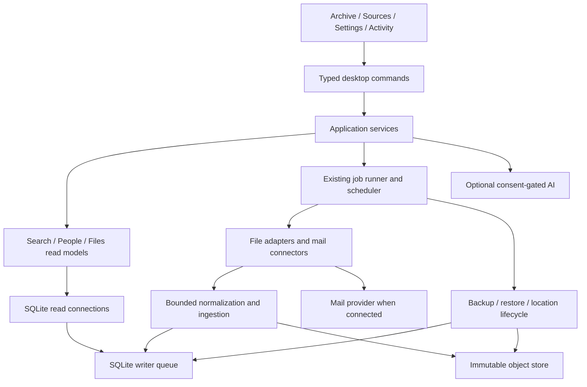

# A local archive people can trust and find things in

Date: 2026-11-17. Status: **proposed product and architecture plan; no application changes implemented by this document**.

Inspected baseline: `4596a7ebe257b0fe1f2316b03c8ee4e6b1f91581`, plus the existing working-tree UI edits. This is a source and documentation investigation, not a fresh native-app or installer test. [Investigation evidence](evidence/archive-experience-investigation-2026-11-17.md) records inspected files, issue reconciliation, provider sources, and limitations.

## 1. Recommendation

Keep the existing Tauri 2, Rust, TypeScript, SQLite FTS5, object-store, and background-job architecture. Build a coherent preservation and retrieval experience on it. A framework replacement, hosted backend, microservices, or general connector plugin system would add work without resolving the main gaps.

Organize the product around three user outcomes:

1. **Keep it:** bring messages and available files into a local archive, with understandable coverage and failures.
2. **Find it:** search across sources, browse a person, open a conversation, or find a photo/document.
3. **Keep control:** know where the archive lives, make a verified second copy, restore it, and export readable data.

The existing code already covers substantial parts of all three. The largest new capabilities are safe vault-location selection, user-confirmed People, an archive-wide Files view, readable HTML export, and consumer-grade provider onboarding. The most urgent work is to make existing preservation, recovery, and status behavior understandable and demonstrably reliable.

The “safe with a search bar” is a useful experience goal. It must not imply app encryption, complete provider history, or protection against losing the only disk containing the archive.

## 2. Scope and documentation ownership

This document plans the requested end state and recommends an implementation order. It supplements, rather than silently replaces, the existing specification set:

| Existing owner | How this proposal relates |
| --- | --- |
| [Product plan](product-plan.md) | Existing release scope remains authoritative; adopt each new capability there when its implementation slice begins |
| [UX specification](ux-specification.md) | Owns approved interaction contracts; incorporate the journeys below per slice |
| [Architecture](architecture.md) and [data/API contracts](data-and-api-contracts.md) | Preserve storage, identity, job, and recovery invariants; add People, Files, and vault-location contracts before their migrations |
| [Implementation roadmap](implementation-roadmap.md) | M1–M7 remain the implementation history; the work packages below extend and reconcile that roadmap |
| [User success plan](internal/user-success-plan.md) | Reuse U03–U09 and the existing research/pilot kits instead of commissioning another parallel discovery process |
| [Validation and release](validation-and-release.md) | Existing recovery, privacy, accessibility, and native-release requirements still apply |
| [Decisions](decisions.md) | Record adopted architectural decisions, preserving earlier rationale |

The provided “40% want local/private storage” and shutdown-triggered demand claims are **user-supplied hypotheses**. No original page or sample was supplied, so this investigation does not validate the percentage or infer market size. Test the motivation through the existing research playbook. Pricing and private launch strategy stay outside this repository under the documented repository policy.

## 3. Current capability versus remaining work

“Present” below means inspected in source, not newly verified at runtime.

| User need | Present in this app | Remaining work |
| --- | --- | --- |
| Desktop, offline archive | Tauri 2; Rust core; SQLite FTS5; copied media objects | Retain architecture; validate distributed artifacts per OS |
| Choose archive folder | Vault is opened in Tauri's app-data directory; location is displayed in Storage & backup | Bootstrap location registry, safe move/open, external-drive absence handling, per-vault lock |
| Guided file import | File/folder/ZIP detection, native pickers, preview, progress, retry, source choice, timezone confirmation | Provider-specific guides, clearer coverage receipt; finish ambiguous date and identity handling |
| Supported sources | MBOX/EML; WhatsApp, Telegram, Signal, Discord, Messenger and app JSONL variants; IMAP | Explicit supported export variants; Skype and Slack adapters; Takeout container guidance |
| Google sign-in | BYO-client OAuth using Gmail IMAP/XOAUTH2; app-password route | Public-client onboarding and a Gmail API read-only connector are separate work |
| Microsoft sign-in | Generic IMAP is present; no inspected Microsoft OAuth/Graph connector | Delegated Microsoft Graph connector and consent/account-type validation |
| Background imports | Scheduler, folder watching, optional tray and login startup | Durable freshness projection, useful tray status, manual-export reminders; optional backup schedule |
| Cross-source search | Flat FTS5 results, source/date/author/attachment filters, context and export | Make scope obvious; People and Files reuse the same filter semantics |
| Trust filters | Assumed time, unverified grouping, and missing-file filters exist in request/UI code | Verify end-to-end acceptance and reconcile issue #108 |
| People | Author string filtering and statistics | Stable participant identities, reversible user links, People timeline and filtering |
| Read messages | Context reader, media controls, sandboxed rendered email when retained HTML exists | Chat-specific presentation and clearer email structure; preserve time and grouping caveats |
| Photos and documents | Per-message media and safe open/export; source object registry | Indexed archive-wide Files view, thumbnails, message/source navigation |
| Portability | CSV, JSONL, email-only MBOX; selected-message text/JSON; verified-backup machinery | Human-readable HTML bundle; explicit SQLite snapshot export and fidelity labels |
| Recovery | Manifest/checksum backup, staged restore, journaled switch, previous-vault recovery | Fresh candidate proofs and user comprehension; location move must extend these guarantees |

Two open issues are reconciliation work, not evidence of absent code: [#112](https://github.com/acailic/mailchat-vault/issues/112) describes missing Signal media, but extraction and tests exist; [#108](https://github.com/acailic/mailchat-vault/issues/108) describes missing trust filters, but request fields and controls exist. [#170](https://github.com/acailic/mailchat-vault/issues/170) is the existing People feature scope and should own that implementation.

## 4. Information architecture

Keep **Archive, Sources, Settings** as primary destinations, with Activity secondary. Inside Archive add **Messages, People, Files** views. This extends the current navigation without putting every feature in the sidebar. Optional Ask remains subordinate to ordinary local retrieval.

| Surface | Main question it answers | Primary action |
| --- | --- | --- |
| Archive / Messages | Where is that message? | Search and open original context |
| Archive / People | What did I exchange with this person? | Open person; manage confirmed identities |
| Archive / Files | Where is that photo or document? | Preview, open associated message, export |
| Sources | What have I saved, and what needs attention? | Add source; update or reconnect an existing source |
| Settings / Storage & backup | Where is it, and can I recover it? | Create backup; inspect/restore; move archive |
| Activity | What happened during an operation? | Inspect issues, retry, or cancel active work |

Illustrative layout, not a visual mockup:

```text
Archive     Search messages and filenames…             Add source
            Messages   People   Files
            All sources · All dates · Filters

            Email · Personal Gmail     Apartment lease
            WhatsApp · Landlord        Signed copy attached
            ...                        [original conversation]

Sources     Gmail updated 2 hours ago · WhatsApp export imported Nov 1
Settings    Backup verified Nov 10 · 3 files missing → Review
Activity
```

“Search messages and filenames” is target copy only after the relevant filename query path exists. Do not imply PDF contents, OCR, or general semantic understanding. In People, the initial search locates people by label and linked identity; a person's timeline has an explicit “Search messages with this person” scope. Files searches filenames/metadata initially. Switching views must display any changed scope and preserve the previous view's state.

Results retain source **instance** labels, not only provider logos: two Gmail accounts must remain distinguishable. Use text beside icons, accessible names, visible keyboard focus, and the existing wide/medium/compact layout behavior. A folder tree may be an advanced source filter; it is not the initial navigation model.

First run emphasizes **Add messages**, **Open an existing archive**, and the isolated sample archive. Returning users see search, bounded recent content, and a quiet preservation status. A failure requiring action can override that quiet status; ordinary progress should not take over the workspace.

## 5. User journeys and state transitions

### 5.1 Install, choose storage, and reopen

Offer the current local app-data location as the default, with native **Choose another folder** and **Open existing archive** actions. Validate write access, supported filesystem, free space, existing vault identity, and schema compatibility before creating anything. Explain that an external drive must be connected to use its archive.

An existing installation keeps its current location until the user requests a move. A missing or unplugged vault opens a recovery/location screen, never an empty replacement archive. Do not infer that a different directory with the same name is the same vault.

Recommended copy: “Your archive and ordinary search stay on this device. Connecting email contacts your provider. Optional AI can send approved content to its configured provider. The archive relies on your device's disk protection.” AI wording must match the actual consent mechanism; the current session-level consent is not exact per-payload approval.

### 5.2 Add an export

`Choose source → get export instructions → pick/drop file → inspect → resolve choices → import → receipt → open first result`.

The provider guide states the supported export format, whether media must be included, what the user needs permission to export, and what cannot be recovered. It ends in the same shared import path as drag and drop. Detection follows content, not just filename extension.

The confirmation page shows source/destination, detected conversations, sampled date range, whether counts are complete or lower bounds, files detected/missing, timezone/date assumptions, and estimated space. Bind confirmation to a file/manifest fingerprint and the chosen interpretation; if input changes before execution, re-inspect it. Do not trust a stale preview as permission to import changed bytes.

Use a real progress percentage only when the denominator is known. Otherwise show phase, processed messages/bytes, and cancellable activity. On completion, report **new messages, already present, failed records, files preserved, and files missing**, plus observed date range. An observed range is not proof of complete history between its endpoints.

Cancellation keeps committed work and explains safe retry. A reimport updates provenance and fills missing media where possible without duplicating messages or erasing legitimate repeated chat messages. Failure offers a source-specific remedy and opens retained issues from the receipt.

### 5.3 Connect email

`Choose provider → explain granted access → browser sign-in → select folders/scope → initial download → receipt → choose future updates`.

The scope notice distinguishes **what the app does** from **what the OAuth grant permits**. Existing Gmail IMAP is read-only in its commands but uses a broader OAuth scope. Until a public connector is ready, label it advanced setup and offer file import; do not present user-created developer credentials as one-click onboarding.

Save working credentials only after validation; reconnect failures must not destroy a working credential. Tokens remain in the OS keychain with the existing explicit session fallback. Disconnect stops future access and forgets credentials while keeping archived data. No provider deletion, label change, or read-flag update may be inferred from “sync.”

### 5.4 Leave it running

After first success, offer optional automatic updates, tray keep-alive, and login startup. Keep the existing opt-in defaults. Explain that updates run while the app process is running; sleep, quit, offline state, or an absent external drive can delay work.

Show separate facts:

- **Email updated:** last successful committed sync, plus unresolved failures and scope.
- **Manual export imported:** when an export was imported, its observed range, and an optional next reminder.
- **Backup verified:** when a complete backup passed verification and where it was written.

Never label a successful sync “backup complete.” An archive and a second recoverable copy are different protections. Same-disk backups help with some mistakes but do not protect against losing that disk.

Manual-export reminders are opt-in per source, default monthly when enabled, locally scheduled, snoozable, and content-free. They may fire on next launch after the app was closed; they do not promise OS background execution after Quit. Reimporting unchanged content must not falsely advance the source's known historical coverage.

### 5.5 Return and find something

Keep one prominent local search. A query such as “apartment lease 2019” should find matching email and chat material together when those terms are present. Offer an explicit year filter; do not silently treat every number as a date. Natural-language interpretation remains optional and visibly distinct.

Open email with subject/from/to/date and a safe rendered/plain choice. Show chats with sender, ordered message bubbles, attachment cards, and adjacent context. Bubble alignment requires known self identity; when unknown, use neutral alignment rather than guessing. Render group conversations as groups, even when reached through a person.

Preserve original author, source, conversation, time confidence, missing-file indicators, and stable message links. A selected result remains open during background imports. Counts and rows use one read snapshot; archive revisions make refresh explicit, as the current search contract already does.

### 5.6 Export and recover

One Export action offers **selected messages**, **current results**, **conversation**, or **person timeline** where applicable. Show the scope and count before writing. Export all matching pages, not only the visible page.

Keep full-archive backup in Storage & backup. Restore remains inspect → validate → preview changes → explicit replace → recoverable switch/restart. Restored accounts require reconnection. Credentials are never part of portable files.

## 6. Domain model: evidence and organization

Keep imported records and their provenance authoritative. User labels and identity assignments are a separate, reversible layer. Existing `message_identities` identifies **messages**, not people; do not repurpose it.

Proposed additions, with final SQL and migration versions owned by the implementing slice:

| Entity | Key facts and constraints |
| --- | --- |
| `people` | Vault-local UUID, user label, created/updated timestamps; no network contact upload |
| `participant_identities` | Stable ID; source-instance ID; provider namespace/key when present; original label; confidence; ambiguity scope |
| `message_participants` | Message ID + identity ID + role (`sender`, `to`, `cc`, other explicit participant); unique relationship; derived only from actual evidence |
| `person_identity_links` | Identity → one person, explicitly confirmed; assignment revision and confirmation time; conflict requires explicit reassignment |
| `person_link_history` | Minimal undo/audit record of confirmed association changes; no rewritten message payload |
| `attachment_refs` | Message/source/import provenance, original name/type, object digest if preserved, availability/reason; many references may share one object |
| `source_receipts` | Durable completed import/sync facts and scope; separates observed dates from proven completeness; no message bodies in summaries |
| `reminder_preferences` | Source, enabled, interval, next due, snooze/dismiss state; device-local notification scheduling |

The existing media registry covers unlinked objects, while many message attachments live in `raw_json.media`. Add an indexed attachment projection with a resumable backfill; do not assume the existing registry is already a complete gallery index. Keep raw imported metadata. Define one authoritative write path and validate projection coverage before switching readers; avoid independently mutable duplicate attachment stores.

### People rules

1. Stable provider IDs and source instance anchor identities. An email address is identity evidence, not automatic proof that two source accounts represent the same human.
2. Name-only chat identities are visibly ambiguous and scoped conservatively to source/conversation. Two “Mom” or “Alex” labels must never cause an automatic link. Allow explicit subsets where a single label may represent different people.
3. Linking previews affected identities, counts, and representative messages. Confirm/unlink transactions bump an organization revision so pagination and caches cannot show a silently changed person.
4. New imports with an already confirmed stable identity appear automatically. Changed or ambiguous identities require review.
5. Default timeline includes messages sent by the linked identities and messages explicitly addressed to them when recipient evidence exists. Group neighbors appear only through conversation context; do not attribute an entire group to one person. State limitations where exports lack recipient/self identity.
6. Person deletion removes organization only. It does not delete messages, merge message revisions, join conversations, or rewrite sender strings.
7. Links, identities, and participant relationships survive backup/restore. The sample archive has separate organization state and cannot modify personal links.

## 7. Technical organization

Use a **modular desktop application**: one process, one active vault, explicit feature boundaries, shared storage/job infrastructure. The main concentration of responsibility is in `src/main.ts` (~3,500 lines), `src-tauri/src/lib.rs` (~4,400), and `storage.rs` (~4,700). File size alone is not a defect, but these files currently combine unrelated orchestration responsibilities, making cross-cutting features harder to isolate.



Arrows to SQLite denote access through the existing pool, not permission to bypass it. Network, parsing, media decoding, native dialogs, and consent waits never hold database transactions.

### Proposed source layout

Extract by responsibility as each feature changes; retain compatibility exports while callers move. Do not begin with a repository-wide rename.

| Boundary | Target ownership | First extraction |
| --- | --- | --- |
| `src/app/` | Bootstrap, routing, shared navigation, composition | Reduce `main.ts` to feature wiring |
| `src/features/archive/` | Query controller, results, selection, conversation reader | Existing search/detail listeners and sequence guards |
| `src/features/people/`, `files/` | Feature state, views, controllers | New features live here from the start |
| `src/features/sources/` | Guided source setup, preview/import, account recovery | Existing import/account/scheduler view composition |
| `src/features/recovery/`, `settings/`, `activity/` | Recovery flows and their state; settings; job history | Reuse existing pure view helpers |
| `src/shared/` | UI primitives, formatting, IPC client and DTOs | No feature-to-feature DOM imports |
| `src-tauri/src/commands/` | Thin IPC validation and delegation by capability | Search/import/recovery command groups |
| `src-tauri/src/services/` | Vault session, secret resolution, notifications, OS integration | Centralize data-dir and lifecycle access first |
| `crates/vault-core/src/people/`, `files/`, `sources/` | Domain operations, read queries, projections | Add domain services without Tauri dependencies |
| `crates/vault-core/src/storage/` | Migrations, repositories, transaction helpers | Extract without changing applied migration contents |
| Existing parser modules | Provider-specific parsing, capabilities and fixtures | Keep shared bounded import contracts |

Do not add a generic repository abstraction over every SQL statement. Keep SQL close to domain queries; keep one writer and existing read connections. Feature controllers own cancellation/stale-response guards and expose explicit lifecycle methods instead of importing global DOM state.

### Connector capability contract

A small internal, statically registered descriptor is enough: provider/kind, accepted formats, input mode, auth mode, media support, identity quality, incremental support, known export limits, and guide version/date. The chooser, preview, and support documentation should derive supported options from the same capability facts.

File adapters emit bounded normalized messages, participant evidence, media references, and parse issues. Network adapters produce the same ingest contract plus opaque provider checkpoints. Do not force Gmail history IDs or Graph delta URLs into the IMAP UIDVALIDITY schema. Commit each batch's records, occurrences, failures, and safe checkpoint together. Remote deletion changes provider-presence evidence, never removes local archived content automatically.

### Proposed API additions

Use the existing IPC serialization/error conventions. These names are design proposals, not available commands:

- People: `people_list`, `person_link_preview`, `person_links_commit`, `person_update`, `person_delete`, `person_timeline`. Preview/commit binds identity set, operation and organization revision; stale approval is rejected.
- Search: optional `person_id` filter with backward-compatible defaults; all existing filters remain conjunctive. Export uses the exact same normalized scope.
- Files: `files_search`, `file_references`, `thumbnail_get`; return object IDs and controlled URLs, never arbitrary filesystem paths. Distinguish unique-file grouping from attachment-occurrence counts.
- Vault: `vault_location_inspect`, `vault_move_preview`, `vault_move_commit`, `vault_open`; all destructive replacement stays behind validated preview and exclusive lifecycle ownership.
- Status: `archive_health` and `source_receipts`; derive read models from committed facts, not frontend timers or the bounded recent-activity list alone.
- Long operations: extend existing `job_submit` kinds for HTML export, attachment backfill, thumbnails, and scheduled backup rather than inventing another progress/cancellation system.

Preserve existing offset search APIs until a measured need warrants replacement. New large People/Files timelines should use stable cursors containing sort keys and relevant archive/organization revision; unknown dates have a separate explicit section, not invented positions. Additive DTO fields need old-caller defaults and Rust/TypeScript contract tests.

## 8. Vault location and recovery design

This is a lifecycle change, not a file-picker enhancement. Multiple current commands, media serving, settings, watchers, and backup jobs obtain `app_data_dir()` directly. They must all resolve through one `VaultSession` before custom locations are enabled.

Proposed separation:

```text
OS application-data directory
  bootstrap.json        active vault UUID/path; device preferences
  device logs/cache     sanitized; no credentials or message content

User-selected vault directory
  vault.json            stable UUID and format metadata
  vault.db              existing canonical archive + organization tables
  settings.json         portable, non-secret vault preferences
  media/                immutable copied objects

Sibling recovery area   existing staged restores and previous vaults
OS keychain             provider credentials, scoped by vault/source identity
```

Keep ephemeral thumbnails rebuildable and out of backup requirements. Login startup, tray preferences, notification permissions, watched absolute paths, and active-vault pointers are device-specific. Restoring portable preferences must not silently activate old machine paths or scheduled network access. Migrate current settings compatibly rather than moving them all at once.

Support one active vault per application instance initially. Acquire an exclusive advisory vault lock before migration or writer startup; bind bootstrap selection to the vault UUID. The app-identity single-instance plugin is useful but does not establish ownership of a portable directory across copies/users. Refuse network filesystems for active WAL databases; SQLite documents that WAL requires participants on the same host. Cloud-synchronized live vault directories are outside the supported configuration; support copying completed backups instead. [SQLite WAL documentation](https://www.sqlite.org/wal.html)

Move protocol:

1. Inspect destination, free space, format, permissions and volume suitability. No overwrite of an unrelated directory or vault.
2. Acquire lifecycle ownership; stop new jobs/watch events, finish or cancel current work, and hold writers stable. Create a consistent SQLite snapshot and the referenced object inventory.
3. Copy snapshot, objects and portable metadata into staging on the destination volume; verify checksums and database integrity. Cross-volume moves are copies, not assumed atomic renames.
4. Close pool/media handles, finalize the verified destination, and atomically update a device-local move journal/bootstrap pointer. Journal phases include both vault identities/paths and recoverable intent.
5. Restart into the selected vault. Retain the old copy until the user separately removes it. Ensure only the selected copy is writable through this app.

On interruption, startup resolves the journal before opening a pool. Test crashes around every phase, destination disconnection, disk full, renamed mount points and permission loss. If an active external drive disappears, stop new writes and report storage unavailable; do not recreate its path, continue buffered writes under a replacement mount, or fall back to a blank vault. Prefer internal active storage plus external backups in onboarding; external active storage remains supported only after its failure tests pass.

## 9. Files, originals, and export fidelity

Files shows Photos, Videos, Audio and Documents, filtered by source/person/date/availability. Default thumbnails are local, bounded, lazy and cached. Unknown media types get an icon. Do not decode full-size libraries in the UI or fetch remote attachment URLs automatically. Missing references remain inspectable through a clearly labeled filter.

One stored object can have many attachment references. A gallery tile may group identical bytes, but its details must list every referring message/source. Preserve source-level unlinked files without inventing a message association. Respect existing `stage → promote → reference` storage order and keep cancellation/disk-full behavior explicit.

The current normalized mail record and reconstructed MBOX are not equivalent to preserving every original MIME message. Add opt-in/default-policy-defined original retention for **new imports**: raw RFC 5322 bytes for mail and original export inputs/manifests where available, with storage estimates. Old records remain labeled “original not retained”; never fabricate originals from parsed fields. Deduplicate original objects by digest and include their references in backup/reconciliation.

| Output | Intended use | Fidelity/limitation |
| --- | --- | --- |
| CSV / JSONL | Analysis and programmatic interchange | Existing formats; document whether relationships/media bytes accompany them; JSONL alone is not a full-vault restore |
| MBOX | Open email in another mail application | Email only; explain skipped chats; current reconstructed format is not guaranteed byte-exact original MIME |
| HTML bundle | Read without Mailchat Vault | New: static escaped pages + copied selected files + provenance/missing-file manifest; no JavaScript or remote assets required |
| SQLite snapshot | Inspect structured archive independently | New explicit action: consistent snapshot, schema/version README; database alone excludes media bytes and keychain secrets |
| Vault backup | Recover the whole archive | Existing container, verified manifest/database/objects/settings, extended for People and new object references; credentials excluded |

HTML exports must use safe generated names, relative asset references, bounded streaming, exact query scope, and a final manifest. Render unsafe original HTML as inert content through the export policy, not by copying it into an unrestricted browser document. A cancelled export leaves a clearly incomplete staging artifact, never a successful-looking finished bundle.

## 10. Provider plan and constraints

| Provider/path | Recommendation | Prerequisite for a supported user promise |
| --- | --- | --- |
| Gmail file import | Lead with existing MBOX ingestion and a Takeout guide | Verify actual exported MBOX variants and nested/multipart Takeout handling; whole Takeout ZIP support must not be inferred from generic ZIP support |
| Gmail advanced live access | Keep existing BYO OAuth/app-password routes clearly labeled | Explain broader IMAP authorization; retain mock/live-account validation |
| Gmail consumer sign-in | Build a Gmail API connector using `gmail.readonly`, separate from IMAP | Registered public client, verification determination, full MIME/media/history-cursor parity and reconnect tests |
| Outlook / Microsoft 365 | Add Graph delegated `Mail.Read` via a public desktop OAuth client | Personal/work accounts, tenant consent restrictions, folder traversal, MIME/media parity, pagination/delta expiry, throttling and token refresh |
| WhatsApp | Keep manual export and optional reminders | Maintain Android/iOS guides against supported fixtures; export availability/limits are coverage caveats, not “all history” guarantees |
| Telegram / Signal / Discord / Messenger | Finish coverage guidance and verify present implementations | Name exact supported variants; Signal's third-party export prerequisite remains visible; URL-only attachments are not preserved bytes |
| Skype | Support already downloaded archive files after a dedicated adapter/fixture slice | Do not direct users to a future shutdown or promise the expired export window is still available |
| Slack | Add a format adapter only after obtaining representative permitted exports | Explain workspace-role/plan restrictions and missing private/DM scope; file links alone do not mean the bytes were exported |

Google classifies `gmail.readonly` as restricted. IMAP requires the broader `https://mail.google.com/` scope; changing that constant to a REST-only scope would break authentication. Public OAuth verification and a third-party security assessment are separate questions; assessment depends on server access to restricted data. The app's optional remote AI path needs explicit review in that determination. Do not assume either an automatic local-app exemption or an unavoidable paid assessment. [Gmail scopes](https://developers.google.com/workspace/gmail/api/auth/scopes), [IMAP OAuth](https://developers.google.com/workspace/gmail/imap/xoauth2-protocol), [Google verification requirements](https://developers.google.com/identity/protocols/oauth2/production-readiness/restricted-scope-verification)

Microsoft documents delegated `Mail.Read` for personal accounts as well as organizational scenarios; organizational consent policy can still block a user. Use delegated access, not application-wide mailbox permissions. [Microsoft permissions](https://learn.microsoft.com/en-us/graph/permissions-reference#mailread), [consent policy](https://learn.microsoft.com/en-us/entra/identity/enterprise-apps/manage-app-consent-policies)

WhatsApp documents per-chat export. Keep it as the supported route; “manual forever” is an unnecessary prediction. Slack's official export scope varies with role and plan. [WhatsApp export help](https://faq.whatsapp.com/1180414079177245/), [Slack export documentation](https://slack.com/help/articles/201658943-Export-your-workspace-data)

Skype retired on May 5, 2025; Microsoft's published export deadline was June 15, 2026. Both precede this plan. A future shutdown-advice feature must carry an official source, checked date, event date and expiry, and suppress expired urgency. Initially bundle reviewed help with releases; any live advisory feed is a separate opt-in network feature with no archive/profile upload. [Microsoft retirement notice](https://support.microsoft.com/en-us/skype/skype-is-retiring-in-may-2025-what-you-need-to-know)

## 11. Delivery plan

Sizes are relative engineering scope, not calendar promises: S = focused slice, M = several related slices, L = substantial feature/migration, XL = connector or storage program with external dependencies. Estimate after acceptance review; provider approvals and native-host availability do not have reliable engineering-only deadlines.

| ID / priority / size | Deliverable and owner role | Depends on | Acceptance and existing work |
| --- | --- | --- | --- |
| A0 / P0 / S | Reconcile code, support claims and issues; engineer + product | None | Verify #108/#112 acceptance; correct stale docs; record exact revision/tests; reuse M3/M4 records rather than reopening implemented features |
| A1 / P0 / M | Preservation receipts and health model; core + frontend | A0 | Source update/import timestamps distinct from verified backup; partial failures survive restart; status never claims full provider coverage; extends U05/U06 |
| A2 / P0 / M | Guided import and first-success flow; frontend + core | A0 | File/drop routes share preview/confirmation; changed input invalidates preview; receipt opens first result; missing files/date ambiguity recoverable; extends M3.3/U03 |
| A3 / P0 / L | Candidate recovery proof and original-retention policy; core + QA | A0; A1 for final status | Existing backup/restore runbook passes on candidate; source inputs can be removed and kept files still open; new original references round-trip; extends M4/U05/GP04 |
| A4 / P1 / M | Extract vault/session and feature orchestration seams; core + frontend | A0 | Current behavior/IPC remain compatible; all vault-path consumers centralized; existing search/import/restore tests pass; no blanket framework migration |
| A5 / P1 / L | Confirmed People and timeline; core + frontend | A4; A3 before candidate release | Deliver #170 acceptance, duplicate-name/conflict/unlink/future-import tests; additive schema and backup parity; one user can recover from a wrong link |
| A6 / P1 / L | Files projection and gallery; core + frontend | A4; A3 | Resumable projection, source/person filters, unlinked/missing distinction, safe bounded thumbnails, preserved-file navigation; People filtering follows A5 |
| A7 / P1 / L | Storage selection/open/move; desktop + core + QA | A3, A4 | Missing external drive never creates empty archive; all move-journal crash points recover; lock and volume policy tested on every supported OS |
| A8 / P1 / M | Readable conversations and portable export; frontend + core | A4; A5 for person export; A3 for originals | Chat/email presentation retains provenance; HTML works offline without app; SQLite snapshot consistent; scope/count/skipped/fidelity labels correct |
| A9 / P1 / M | Tray health, reminders and optional backup schedule; desktop + frontend | A1, A7 for external targets | Opt-in; no secret/content notifications; no concurrent duplicate source/backup jobs; disconnected destinations and missed schedules handled honestly |
| A10 / P2 / XL | Public Gmail and Microsoft connectors; connector engineer + provider-account owner | A2, A4; provider readiness | Independent Gmail/Graph checkpoints; least necessary grants; revoke/refresh/expiry/rate-limit tests; no server-side content broker required; builds on #82 scope decision |
| A11 / P2 / L | Skype/Slack adapters and broader Takeout ingestion; core | A2, A3 | Golden format fixtures, bounded archive expansion, stable identity, missing-media receipts, idempotence; each provider independently releasable |
| A12 / continuous / M per OS | Accessibility, performance, native evidence and user sessions; QA + product | Each capability; A3 before personal-archive pilot | Existing release matrix and U10 research gates; use exact artifact hashes, observed users, documented failures; no inferred release readiness |

Recommended sequence: **A0 → A1/A2 plus existing recovery proof → A4 → A5/A6 → A7/A8/A9 → provider expansion**. Begin provider account/verification discovery during A0 if consumer sign-in is wanted, so external lead time is visible. It must not block the file-import path. A3's recovery proof is a prerequisite for a preservation pilot; full new original-retention support can be staged with its own honest fidelity boundary.

Some packages can proceed independently, but one migration owner should serialize schema-number allocation and integration. With one engineer, keep one complete user journey in progress at a time. With more capacity, separate UI/read-model work from storage lifecycle work, then integrate through reviewed contracts. No new issues or remote tracker changes were made by this planning task.

### First implementation increment

Deliver one complete, reviewable scenario: import a supported email file and one WhatsApp export, understand exactly what was kept, search across both, open a message/file, create a verified backup, restart, and restore into a disposable vault. Reuse present capabilities; implement only the missing status/flow pieces. Capture the receipts and failure cases as acceptance evidence before expanding connectors or reorganizing every module.

## 12. Validation and release criteria

Run tests proportionate to each implementation slice and reuse existing fixtures. This documentation investigation did not run application suites and does not supersede historical test results.

| Area | Required evidence |
| --- | --- |
| First success | Existing five-session protocol: at least 4/5 representative users import, find, open context/file and explain coverage without facilitator intervention |
| People | Same names across accounts stay separate; explicit links/unlinks and conflicts are reversible; sent/received/group semantics honest; pagination stable during new imports |
| Files | Duplicate bytes with multiple references; absent, corrupt and unlinked objects; dangerous paths; decode limits; filters match message evidence |
| Import | Large bounded inputs; exact versus sampled counts; ambiguous timezone/day-month; changed-input preview; cancellation/retry; ZIP traversal, symlinks and oversized entries |
| Storage | Disk-full and unplug at each copy/switch point; process termination; newer schema refusal; concurrent-open lock; rollback from migration; retained old vault |
| Export/recovery | Exact filtered message IDs, reconstructed-versus-original MIME labels, no credentials; hashes/relations/person links preserved; HTML opens offline; SQLite snapshot survives WAL activity |
| Background | Sleep/wake, clock changes, offline/reconnect, revoked tokens, missing destination, denied notifications, tray unavailable, explicit Quit; truthful last-success stamps |
| Privacy | Offline search/import/file browsing causes no content upload; remote email resources remain blocked; AI disabled/declined produces no provider request; diagnostics contain no secrets or message bodies |
| Performance | Preserve current published budgets; benchmark new People/Files paths and concurrent ingest using named hardware/datasets; do not substitute pure SQL timing for end-to-end latency |
| Desktop delivery | Install/upgrade/reopen/keychain/backup/restore on actual claimed OS artifacts; signing and host limitations remain explicit |

Suggested additional UX performance target, to validate rather than claim: first useful People/Files page within 250 ms p95 on the agreed 100k-message fixture and reference machine, with thumbnails lazy and bounded; include larger stress datasets and missing-media density. Keep existing search capacity/performance acceptance authoritative where stricter.

## 13. Risks and decisions to record during implementation

| Risk or choice | Recommended default | Trigger for revisiting |
| --- | --- | --- |
| Local trust confused with encryption | Plain disclosure; retain OS protection model | Explicit encrypted-vault requirement; then design key recovery and encrypted backups together |
| Wrong people links | Manual preview/confirm, immutable imported author, reversible links | Evidence-based assisted suggestions may be researched later; never silent merges |
| External storage failure | Internal default; verified external backups; strict active-drive recovery | Enable active external vault only after A7 platform evidence |
| Snapshot storage growth | Capacity estimate, content dedup, explicit original-retention policy | Measure actual archive sizes before retention/cleanup automation |
| Public OAuth delays | File-import path remains usable; provider readiness is separate | Start public sign-in implementation when ownership, scope and review route are established |
| Scope growth from every provider | Ship exact, documented export variants | Add source only with representative fixtures and a tested preservation path |
| Fragmented application state | Feature controllers + shared vault session/read models | Further abstraction only when duplicated responsibilities actually appear |
| Documentation/tracker drift | Capability evidence per revision; acceptance reconciliation | A slice cannot be called finished solely from an issue state or merged code |

No answer is required to complete this plan. Recommended defaults allow the first increment to proceed in a future implementation task. Public provider registration, encryption, publishing/signing, or deleting previous vaults are distinct future actions; this document neither performs nor claims them.

## 14. Completion definition

The intended app experience is complete when a regular user can place or reopen their vault, add a supported source with a truthful receipt, leave enabled updates running, find messages across sources, organize confirmed people, browse available files, export independently readable content, and recover from a verified backup. Each promise is limited to tested source variants and verified desktop artifacts. Adding another connector does not compensate for an unproven recovery or misleading completeness claim.
